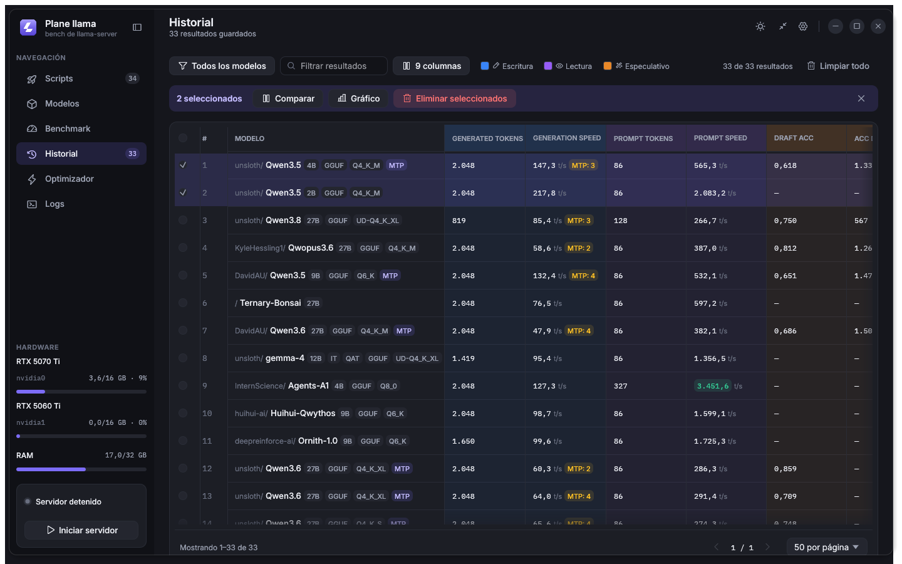
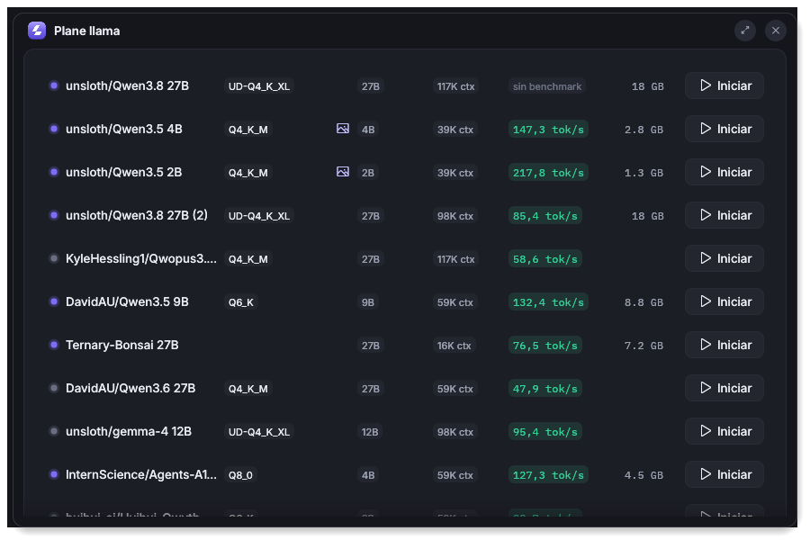
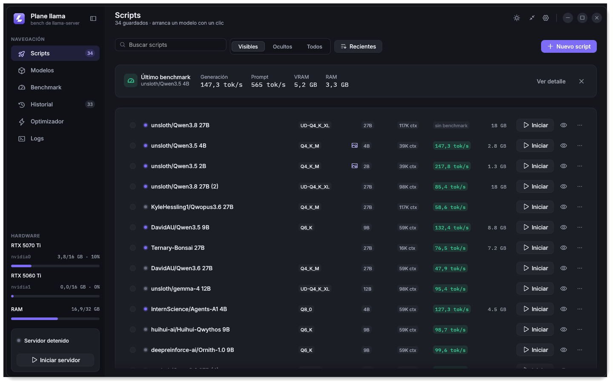
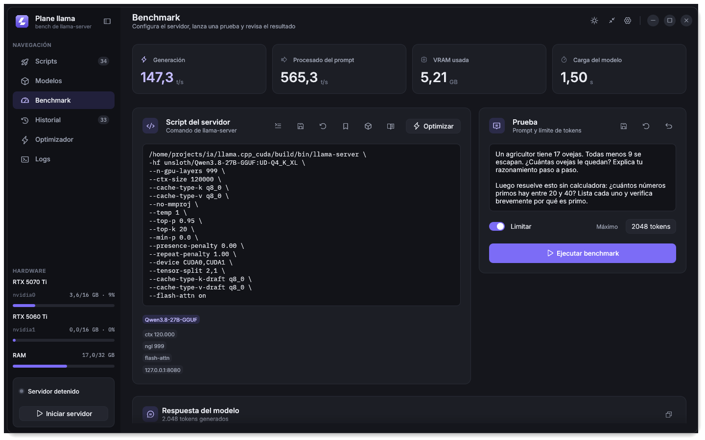
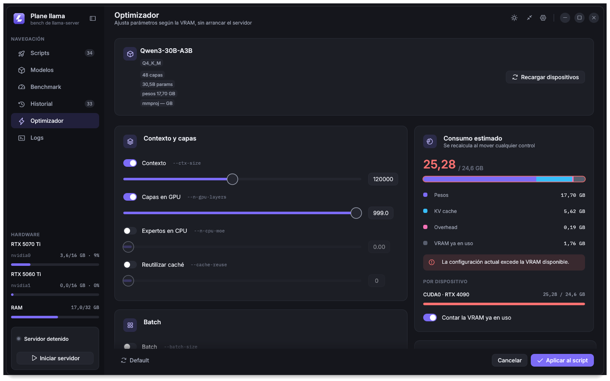
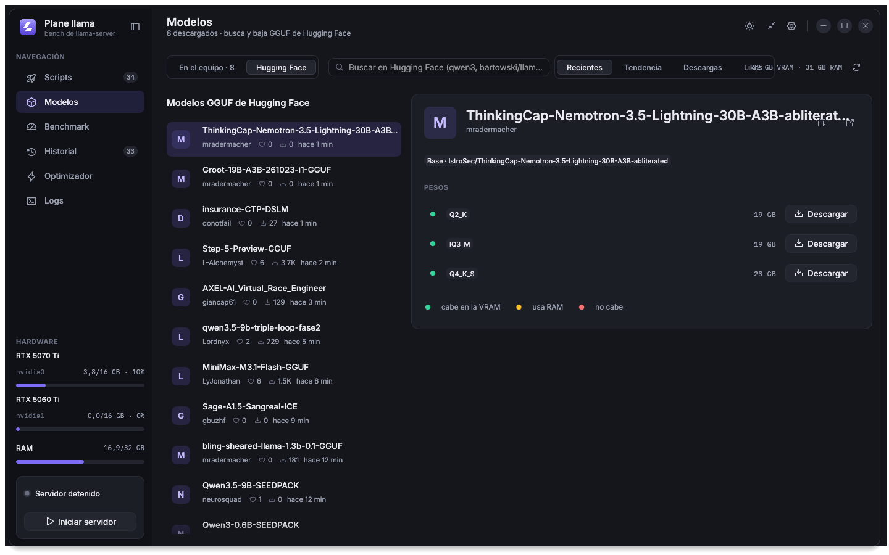
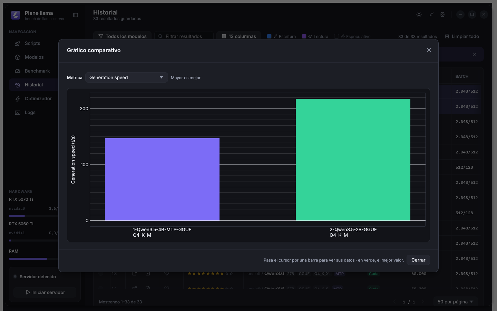
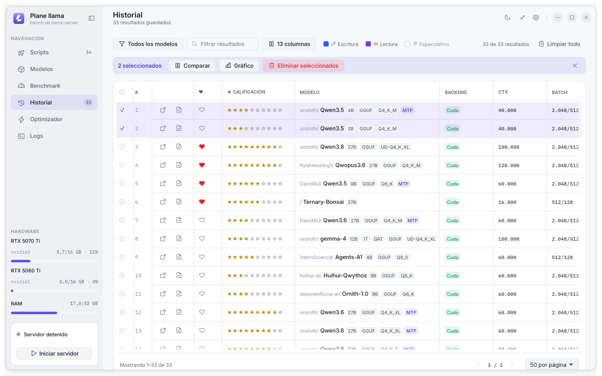

# Plane llama

App de estudio personal para manejo de modelos en local App de escritorio para Linux, escrita en Rust con [egui](https://github.com/emilk/egui),
para **ejecutar modelos de [llama.cpp](https://github.com/ggml-org/llama.cpp) con un
clic** desde una biblioteca de scripts y **medir qué configuración rinde mejor**:
tokens/s de generación y de prompt, VRAM por GPU, RAM y tiempo de carga, con un
historial para comparar corridas.

Es un solo binario: arranca y detiene `llama-server`, lanza el benchmark, estima la
VRAM antes de cargar el modelo y descarga GGUF de Hugging Face. Las funcionalidades
y el know-how están en [docs/funcionalidades.md](docs/funcionalidades.md).



## Capturas

| | |
|---|---|
|  |  |
| **Vista simple**: un clic inicia o detiene un modelo. | **Scripts**: comandos guardados con su mejor tok/s. |
|  |  |
| **Benchmark**: script, prueba y métricas del último resultado. | **Optimizador**: consumo estimado de VRAM sin arrancar el servidor. |
|  |  |
| **Modelos**: caché local y búsqueda en Hugging Face. | **Gráfico**: compara las corridas seleccionadas. |

<details>
<summary>Tema claro</summary>



</details>

## Instalación

### Requisitos

- Linux con Wayland o X11 y OpenGL (o Vulkan con `PLANE_LLAMA_RENDERER=wgpu`).
- [`llama-server`](https://github.com/ggml-org/llama.cpp) en el `PATH`, o su ruta
  absoluta en cada script.
- GPU NVIDIA para las métricas de VRAM (se leen con `nvidia-smi` y sysfs). Sin ella
  la app funciona y mide RAM y tokens/s.
- Para compilar: [Rust estable](https://rustup.rs) (lo fija `rust-toolchain.toml`) y
  un compilador de C. [`just`](https://github.com/casey/just) es opcional.
- Bandeja del sistema en GNOME: la extensión AppIndicator.

### Compilar e instalar

```bash
git clone https://github.com/wfpaisa/plane-llama.git
cd plane-llama
just install
```

`just install` compila en release y deja, para el usuario actual:

| Archivo | Destino |
|---|---|
| Binario | `~/.local/bin/plane-llama-egui` |
| Iconos | `~/.local/share/icons/hicolor/…/plane-llama-egui.*` |
| Acceso del menú | `~/.local/share/applications/plane-llama-egui.desktop` |

Después abre **Plane llama** desde el menú de aplicaciones o ejecuta
`plane-llama-egui`. Si `~/.local/bin` no está en el `PATH`, agrégalo.

Sin `just`, el equivalente mínimo es:

```bash
cargo build --release -p plane-llama
install -Dm755 target/release/plane-llama ~/.local/bin/plane-llama-egui
```

### Actualizar y desinstalar

```bash
git pull && just install
```

```bash
just uninstall
```

`just uninstall` retira el binario, los iconos, el acceso y el arranque automático;
conserva los datos.

### Opciones de arranque

| Opción | Efecto |
|---|---|
| `--hidden` | Arranca en la bandeja, sin mostrar la ventana. |
| `PLANE_LLAMA_RENDERER=wgpu` | Usa Vulkan en lugar de OpenGL (glow, por defecto). |
| `PLANE_LLAMA_BACKEND=x11` | Abre la ventana por XWayland (útil con tabletas gráficas). |
| `DATA_DIR=<carpeta>` | Guarda los datos en otra carpeta. |
| `HF_TOKEN` | Token para descargar repos restringidos de Hugging Face. |

## Datos

Se guardan en `~/.config/plane-llama` (`history.json`, `scripts.json`, script y
prompt por defecto, favoritos de flags, `ui.ron`). Los modelos no se copian: se
leen de la caché de Hugging Face (`HF_HUB_CACHE` o `HF_HOME` la cambian). La
variable `DATA_DIR` permite usar otra carpeta.

El formato es el mismo de llama-bench, la versión Electron. Para abrir su historial
sin tocarlo:

```bash
cp -r ~/.config/llama-bench /tmp/plane-llama-data && DATA_DIR=/tmp/plane-llama-data just dev
```

## Uso

### Vista simple y vista ampliada

La app abre en la **vista simple**: una ventana pequeña, centrada, con la lista de
scripts agrupada por organización. Un clic en un script arranca `llama-server`; otro
clic lo detiene; el clic derecho permite editar, medir, abrir el chat u ocultar. Solo
tiene dos botones: **Vista ampliada** y cerrar. La elección se guarda y la ventana se
vuelve a abrir con el tamaño de cada vista.

La **vista ampliada** tiene todas las páginas:

- **Scripts**: la biblioteca de comandos de `llama-server` (`DATA_DIR/scripts.json`).
  La primera vez se crea con el script por defecto y los scripts del historial,
  del más rápido al más lento. Se puede buscar, ordenar (recientes, más rápidos,
  nombre, tamaño), elegir qué scripts se ven y marcar favoritos. Cada fila
  muestra cuantización, parámetros, contexto, mejor tok/s y tamaño, con
  **Iniciar** / **Detener** y un menú para editar, medir, duplicar u ocultar.
- **Modelos**: los modelos de la caché de Hugging Face (`~/.cache/huggingface/hub`)
  agrupados por organización, para crear un script o ponerlos en el actual; y
  la búsqueda en Hugging Face con el modelo base y los pesos por cuantización,
  con un indicador de si caben en VRAM. Las descargas van a la caché estándar,
  se reanudan y `llama-server -hf` las usa sin conexión. Para repos restringidos
  se usa `HF_TOKEN` o el token de `hf auth login`.
- Las tarjetas gráficas se muestran por nombre («RTX 5070 Ti») con su
  identificador (`nvidia0`) debajo.

### Segundo plano y arranque automático

El botón de engranaje abre **Ajustes**: puedes mantener la app en la bandeja al cerrar,
iniciarla con la sesión, empezar oculta y guardar una copia del script del editor
para ejecutarla al abrir la app. **Quitar** desactiva ese script. Guardar cambios
no inicia el servidor en ese momento.

El autostart apunta al ejecutable que lo activó: conviene activarlo desde la
versión instalada en `~/.local/bin/plane-llama-egui`.

La bandeja usa StatusNotifierItem por D-Bus con ksni. En GNOME Wayland requiere
la extensión AppIndicator activa. Permite abrir, iniciar o detener el servidor
y salir. **Salir** detiene también el servidor. Si no puede crear la bandeja,
la app muestra la ventana y desactiva mantenerla en la bandeja durante esa sesión.

`plane-llama-egui --hidden` arranca sin mostrar la ventana. Otra ejecución pide
mostrar la instancia existente mediante
`$XDG_RUNTIME_DIR/plane-llama-egui.sock`. Con la ventana oculta se suspenden
las consultas de GPU y los repintados por logs y estado; al abrir se refrescan.

### Diseño de la interfaz

La ventana dibuja su propio marco: esquinas redondeadas, borde claro y sombra (sin
sombra ni esquinas al maximizarla). En **Ajustes → Apariencia** se activa
**Desenfocar el fondo**, que usa `ext_background_effect_v1` (GNOME 51 o posterior).

La interfaz usa una paleta propia con un color de acento configurable en
**Ajustes → Apariencia** (violeta por defecto, ocho predefinidos o uno propio), tipografía Inter (Regular,
Medium y SemiBold), IBM Plex Mono para script, logs y cifras, e iconos Phosphor;
las licencias están en [ATTRIBUTION.md](ATTRIBUTION.md). El detalle del diseño
está en [docs/ui-style.md](docs/ui-style.md). El botón ☀/☾ de la barra superior
alterna claro y oscuro; en **Ajustes → Apariencia** también está **Sistema**. La
elección se conserva en `DATA_DIR/ui.ron`.

En la vista ampliada, la barra lateral lleva la navegación (**Scripts**, **Modelos**,
**Benchmark**, **Historial**, **Optimizador** y **Logs**), los medidores de VRAM y RAM y la tarjeta del servidor para iniciarlo
o detenerlo. Se contrae a iconos con el botón junto al logo.

- **Benchmark**: cuatro indicadores del último resultado, el script y la prueba
  lado a lado (apilados en ventanas estrechas), la respuesta y el detalle completo.
  El catálogo de flags se abre desde el icono de libro del script.
- **Historial**: filtro de texto y por modelo, columnas configurables (con su
  ancho guardado), grupos teñidos de escritura, lectura y especulativo, y una
  barra de acciones (comparar, gráfico, eliminar) al seleccionar filas.
- **Optimizador**: parámetros agrupados por tema y un panel de consumo con barra
  apilada (pesos, KV cache, overhead y VRAM ya en uso). Nada se escribe en el
  script hasta **Aplicar al script**.
- **Logs**: filtro de texto, números de línea y seguimiento del final.

`just screenshots` guarda capturas de todas las páginas con tu historial real en
`target/screenshots` (necesita GPU). Las del README están en `docs/screenshots`.

La barra de título permite arrastrar, maximizar con doble clic, minimizar y cerrar;
los bordes y esquinas permiten redimensionar. Cerrar sigue respetando la bandeja.
Los avisos caducan sin animaciones en bucle y la app conserva el repintado por
entrada o eventos. El test `theme::tests::colours_only_in_theme` impide introducir
colores fuera de `theme.rs`.

## Desarrollo

| Carpeta | Qué es |
|---|---|
| `crates/core` | `plane-llama-core`: toda la lógica, sin UI. |
| `crates/ui` | Componentes egui y tests de interfaz. |
| `apps/plane-llama` | Binario de la app. |
| `tools/fake-llama-server` | Imita a `llama-server` para tests y pruebas manuales. |
| `assets/` | Iconos, fuentes y catálogo de flags de `llama-server`. |
| `vendor/egui-winit` | egui-winit con un hook para centrar la ventana (ver `vendor/PATCH.md`). |

### Tareas

Cargo no tiene un equivalente a los `scripts` de `package.json`. Aquí se usa un
`justfile`: `just` lista las tareas y `just <tarea>` ejecuta una.

| Tarea | Qué hace | Comando equivalente |
|---|---|---|
| `just dev` | App egui en debug | `cargo run -p plane-llama` |
| `just dev-fake` | App egui usando el fake como `llama-server` | ver `justfile` |
| `just run` | App egui en release | `cargo run -p plane-llama --release` |
| `just fake <args>` | Solo el fake server | `cargo run -p fake-llama-server -- <args>` |
| `just test` | Tests del workspace | `cargo test --workspace` |
| `just test-all` | Tests incluidos los ignorados | `cargo test --workspace -- --include-ignored` |
| `just lint` | Formato y clippy estrictos | `cargo fmt --all --check && cargo clippy --workspace --all-targets -- -D warnings` |
| `just fix` | Formatea el código | `cargo fmt --all` |
| `just build` | Build de release | `cargo build --workspace --release` |
| `just export-flags` | Regenera `assets/llama-flags.json` | `bun scripts/export-flags.ts` |

### Probar sin GPU: fake-llama-server

`just dev-fake` compila el fake, lo enlaza como `target/fake-bin/llama-server` y lo
pone primero en el `PATH`. Cualquier script que llame a `llama-server` arranca el
fake: imprime líneas de carga reales, responde `/health` y `/v1/chat/completions`, y
escribe las líneas de timing que parsea el benchmark.

Variables del fake:

| Variable | Efecto |
|---|---|
| `FAKE_LOAD_MS` | Milisegundos que tarda en "cargar el modelo" (300 por defecto) |
| `FAKE_CRASH=1` | Sale con código 1 durante la carga (prueba el fallo rápido) |


`plane-llama-core` expone la fachada `Core` clonable: procesos, benchmark,
calibración, optimizador y utilidades puras en `client`. Cada aplicación debe
llamar `Core::shutdown().await` antes de cerrar su runtime Tokio.

Para ejecutar el servidor de prueba: `cargo run -p fake-llama-server -- --port 8080`.
Acepta `FAKE_LOAD_MS` (300 por defecto), `FAKE_CRASH=1`, `FAKE_CHAT_MS` y
`FAKE_TIMING_DELAY_MS`. No necesita GPU ni modelo.

Las pruebas de procesos viven en `crates/core/tests/processes.rs` y están
registradas en el paquete del fake para que Cargo construya el ejecutable y
proporcione `CARGO_BIN_EXE_fake-llama-server`, sin builds anidados ni dependencia
de un binario preexistente. Se ejecutan con `cargo test --workspace`.

`bun scripts/export-flags.ts [ruta-al-llama-flags.ts]` regenera el catálogo de
`assets/llama-flags.json`; el binario Rust lo incluye y no requiere Bun en ejecución.


### Interfaz y tests

`just dev` abre la app egui con glow. `just dev-fake` usa el servidor simulado;
en **Ejecutar** puedes escribir `llama-server --port 8080` y pulsar
**Iniciar servidor**, o **Ejecutar benchmark** para ejecutar el ciclo completo.

La app guarda la configuración de interfaz en `DATA_DIR/ui.ron`, incluidos el
script, prompt, orden, límite de tokens, columnas y calibraciones por modelo.
Los valores guardados tienen prioridad sobre los defaults del backend. Las
operaciones del core corren fuera del hilo gráfico y el cierre detiene el servidor.

Las pruebas de componentes están en `crates/ui/tests/components.rs`.
El recorrido completo de UI contra el fake se ejecuta con
`cargo test -p fake-llama-server --test ui_benchmark`, también incluido en
`cargo test --workspace`. No necesita pantalla ni GPU. Las decisiones y las
pruebas nativas están detalladas en [docs/progress.md](docs/progress.md).

## Licencia

MIT. Las fuentes, los iconos y el código de terceros tienen sus propias licencias,
listadas en [ATTRIBUTION.md](ATTRIBUTION.md).
